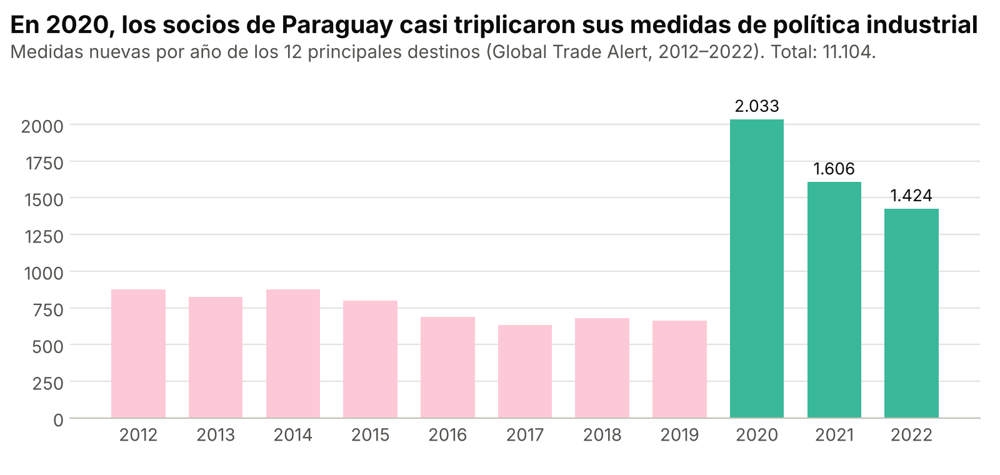
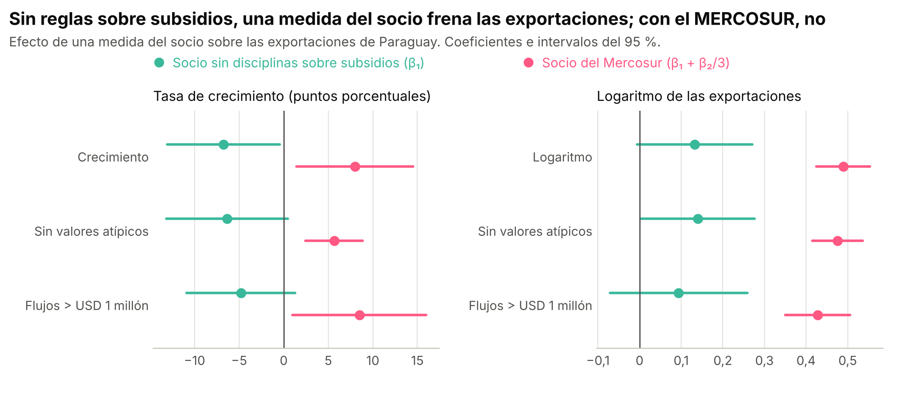
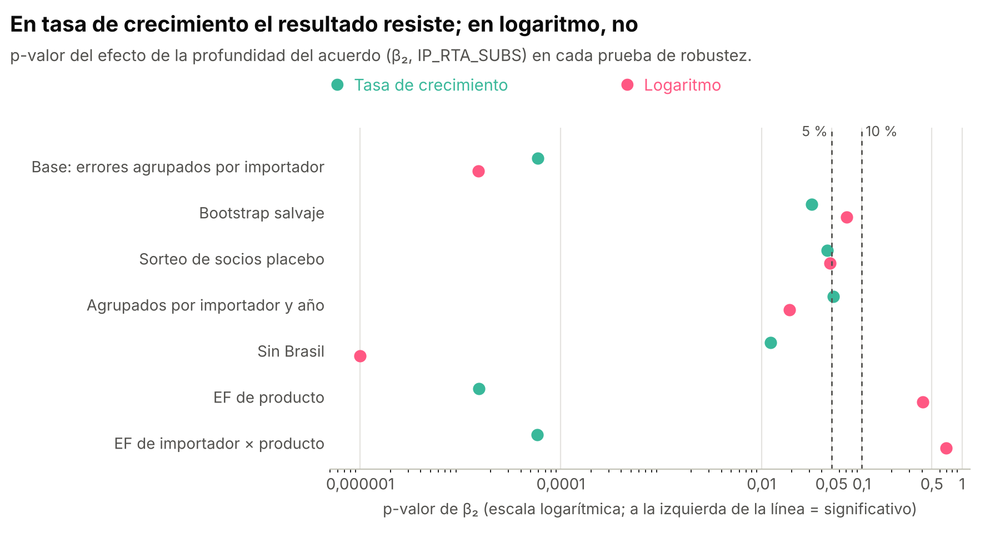
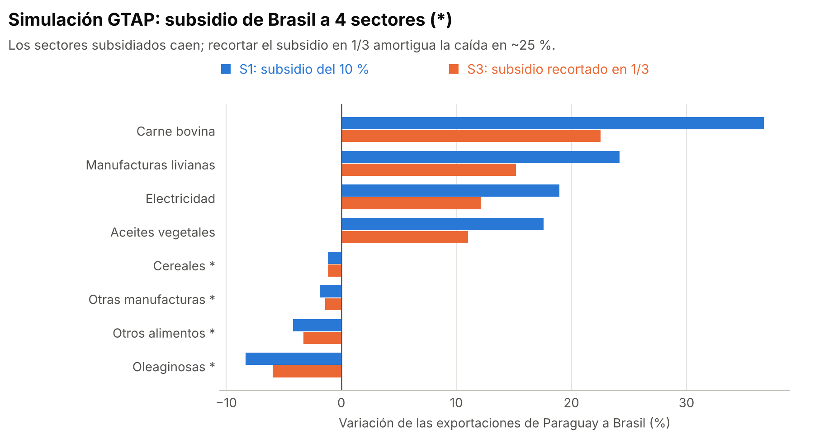

<div align="center">

# Políticas industriales de los socios y exportaciones de Paraguay

**¿Qué pasa con las exportaciones de un país pequeño cuando sus socios comerciales subsidian su propia producción?<br>¿Lo protege un acuerdo comercial con reglas sobre subsidios?**


Trabajo Final de Grado en Economía · Universidad Nacional de Asunción · 2026

[Página web interactiva](https://silvia-mov.github.io/paraguay-exports-industrial-policy/) · [Resultados](#resultados) · [Robustez](docs/robustez.md) · [Cómo correrlo](#cómo-correrlo) · [Correcciones al código original](docs/correcciones.md) · [English](#english-summary)

</div>

---

## En pocas palabras

- **Base:** réplica del paper de **Barattieri, Mattoo y Taglioni (2024)** del
  Banco Mundial, *Trade Effects of Industrial Policies: Are Preferential Agreements
  a Shield?*, traducido de Stata a **Python y R**.
- **Réplica exacta:** con el código original, las Tablas 3 a 7 del paper salen idénticas.
- **3 correcciones** al código original, opcionales y documentadas.
- **Aplicación a Paraguay:** el mismo modelo de gravedad, estimado solo para
  las exportaciones paraguayas, con **25 pruebas y diagnósticos**, cada uno
  [justificado](docs/robustez.md).

## Resultados

### 1. Los socios de Paraguay usan cada vez más la política industrial

<picture>
  <source media="(prefers-color-scheme: dark)" srcset="docs/img/medidas_por_anio_dark.png">
  
</picture>

Los 12 principales destinos de Paraguay aplicaron **11.104 medidas** entre 2012 y
2022, y el **37,2 %** del valor exportado por Paraguay corresponde a productos
alcanzados por al menos una de ellas (USD 36.632 de 98.509 millones exportados a 133
destinos, en los productos y años en que el país que compra aplicó una medida sobre ese
producto; dos tercios, ventas a Brasil y Argentina).

### 2. Sin disciplinas sobre subsidios, una medida frena las exportaciones

<picture>
  <source media="(prefers-color-scheme: dark)" srcset="docs/img/efecto_principal_dark.png">
  
</picture>

> Cuando un socio **sin** disciplinas sobre subsidios aplica una medida, el
> crecimiento de las exportaciones paraguayas del producto alcanzado cae
> **6,77 puntos porcentuales** (p = 0,038), *ceteris paribus*.

Con un socio del **Mercosur**, cuyo acuerdo cubre 4 de las 12 disciplinas sobre
subsidios, el efecto neto ya no es negativo: el acuerdo funciona como **escudo**.
Que el efecto sea positivo, en cambio, no resiste las pruebas con pocos socios
tratados ([detalle](docs/robustez.md#e-los-p-valores-son-confiables-con-tan-pocos-socios-tratados)).

| Ecuación (6) · efectos fijos de importador, año y sector | Crecimiento (pp) | Logaritmo |
|---|---:|---:|
| β₁: medida de un socio sin disciplinas | **−6,77**\*\* (3,22) | 0,133\* (0,071) |
| β₂: × cobertura de disciplinas del acuerdo | **44,25**\*\*\* (10,56) | 1,069\*\*\* (0,238) |
| Socio del Mercosur (β₁ + β₂/3) | 7,98\*\* (3,35) | 0,489\*\*\* (0,033) |
| Observaciones · destinos | 4.354 · 104 | 6.553 · 133 |

<sub>Errores estándar agrupados por importador entre paréntesis. \* p < 0,10; \*\* p < 0,05; \*\*\* p < 0,01. Todas las estimaciones, en [`resultados/`](resultados).</sub>

### 3. ¿Resiste? Sí en tasa de crecimiento; en logaritmo, no

<picture>
  <source media="(prefers-color-scheme: dark)" srcset="docs/img/robustez_pvalores_dark.png">
  
</picture>

En **tasa de crecimiento**, el efecto de la profundidad del acuerdo sigue siendo
significativo al 5 % en casi todas las pruebas (al 10 % con errores agrupados por
importador y año): con *bootstrap*, con un sorteo de socios
placebo, sin Brasil y comparando el mismo producto en el tiempo. Además, pasa la
prueba placebo (una medida del año siguiente no "afecta" las exportaciones de hoy).

En **logaritmo**, el efecto desaparece al comparar el mismo producto y falla el
placebo: refleja **qué** productos se exportan a cada socio, no el efecto de las
medidas.

**[Por qué se eligió cada prueba y qué mostró](docs/robustez.md)**

### 4. Lo mismo, visto con un modelo de equilibrio general (GTAP)

<picture>
  <source media="(prefers-color-scheme: dark)" srcset="docs/img/gtap_dark.png">
  
</picture>

Si Brasil subsidia 4 sectores, Paraguay le vende menos justo en esos sectores
(−4,25 %) y más en los demás. Cuando el subsidio se recorta en un tercio, como
haría una disciplina, la caída se reduce a −3,19 %.

<sub>La simulación se corrió con el modelo GTAP v7 y una base GTAP con licencia, que no
se puede redistribuir; por eso su código no está en este repositorio. Las cifras están
en [`resultados/gtap_por_sector.csv`](resultados/gtap_por_sector.csv).</sub>

### 5. La réplica del paper

Tabla 3, columna 5 del paper (todo el mundo, 8,5 millones de observaciones):

| Versión | IP | IP_RTA_SUBS |
|---|---:|---:|
| Paper (Barattieri, Mattoo y Taglioni, 2024) | −0,773 (0,196) | 2,304 (0,575) |
| Réplica en Stata | −0,773 (0,196) | 2,304 (0,575) |
| Réplica en Python | −0,773 | 2,304 |
| + corrección 1 (acuerdo de mayor cobertura) | −0,757 (0,195) | 2,092 (0,553) |
| + correcciones 1 a 3 | −0,901 | 2,273 |

---

## Datos

| Base | Qué aporta |
|---|---|
| [**BACI**](http://www.cepii.fr/CEPII/en/bdd_modele/bdd_modele_item.asp?id=37) (CEPII), HS 2012 | Comercio bilateral por producto (6 dígitos) |
| [**Global Trade Alert**](https://www.globaltradealert.org/data_extraction) | Medidas de política industrial por país, producto y año |
| [**Deep Trade Agreements 2.0**](https://datatopics.worldbank.org/dta/) (Banco Mundial) | Cobertura de disciplinas sobre subsidios de cada acuerdo |

Los datos **no** están en el repositorio: pesan varios GB y algunas licencias no
permiten redistribuirlos. Para conseguirlos, ver [`docs/datos.md`](docs/datos.md).

## Estructura

```
├── python/          ← traducción a Python (pasos 0–6) + estimación por país (7–14)
├── R/               ← la misma traducción en R (pasos 0–6)
├── stata/           ← do-files originales de los autores + confirmación por país
├── resultados/      ← resultados de la tesis en CSV + scripts de los gráficos y de la página web
└── docs/
    ├── robustez.md      ← por qué cada prueba de robustez
    ├── correcciones.md  ← las 3 correcciones al código original
    ├── datos.md         ← cómo conseguir los datos
    ├── index.html       ← página web (GitHub Pages), datos en datos_pagina.js
    └── img/             ← gráficos del README
```

| # | Qué hace | Stata (original) | Python | R |
|---|---|---|---|---|
| 1 | Acuerdos comerciales y su cobertura de subsidios | `1-DataPrepare_PTA.do` | `1_data_prepare_pta.py` | `1-DataPrepare_PTA.R` |
| 2 | Limpia las medidas de la Global Trade Alert | `2-DataPrepare_GTA_PT1.do` | `2_data_prepare_gta_pt1.py` | `2-DataPrepare_GTA_PT1.R` |
| 3 | Separa la lista de productos de cada medida | `3-Split Sectors-Products.R` | `3_split_sectors_products.py` | `3-Split Sectors-Products.R` |
| 4 | Une comercio, medidas y acuerdos | `4-DataPrepare_GTA_PT2.do` | `4_data_prepare_gta_pt2.py` | `4-DataPrepare_GTA_PT2.R` |
| 5 | Regresiones (Tablas 3–8 del paper) | `5-Regressions.do` | `5_regressions.py` | `5-Regressions.R` |
| 6 | Figuras del paper | `6-Figures.do` | `6_figures.py` | `6-Figures.R` |

Cada script de Python y R tiene como comentario la línea de Stata que traduce, para
compararlos línea por línea.

**Estimación para un país** (extensión de este repositorio; Python):

| # | Qué hace | Script |
|---|---|---|
| 7 | Ecuaciones (2)–(4) y (6), efecto neto del acuerdo, bootstrap, placebo y rezagos | `7_pais.py` |
| 8 | Sorteo de socios placebo, sacar un socio, PPML, diagnósticos, cluster doble | `8_robustez.py` |
| 9 | Placebo con intervalo, efectos fijos de producto, sectores, estudio de eventos | `9_robustez_2.py` |
| 10 | Número efectivo de grupos, intervalos de 3 años; guarda la muestra del país | `10_extra.py` |
| 11 | Subperíodos 2012–2019 vs. 2020–2022 | `11_subperiodos.py` |
| 12–13 | Un solo tipo de subsidio, con su inferencia | `12_tipo_subsidio.py`, `13_tipo_subsidio_inferencia.py` |
| 14 | Junta todo en las tablas de [`resultados/`](resultados) | `14_tablas.py` |

`stata/7_pais_robustez.do` y `7b_pais_boottest.do` repiten la ecuación (6) en Stata
para confirmar los resultados. Qué duda responde cada prueba: [`docs/robustez.md`](docs/robustez.md).

## Cómo correrlo

**Prueba rápida con datos sintéticos** (2 minutos, sin descargar nada):

```bash
pip install -r requirements.txt
python python/tests_make_synthetic_data.py .
python python/0_master.py
```

**Con los datos reales:** descargarlos según [`docs/datos.md`](docs/datos.md) y
correr `python python/0_master.py` (o `R/0-master.R` en RStudio). Hacen falta unos
**16 GB de RAM** y varias horas de ejecución.

**Correcciones:** por defecto el código hace exactamente lo mismo que el original.
Cada corrección se activa con una variable de entorno:

| Variable | Qué corrige |
|---|---|
| `TESIS_VUELTA=2` | Acuerdos superpuestos: usa el de **mayor** cobertura (el original, el de menor) |
| `TESIS_SIN_TRUNCAR=1` | No corta la lista de productos en 2.045 caracteres (`insheet` de Stata) |
| `TESIS_T_MENOS_1=1` | El crecimiento compara siempre con el año anterior |

```bash
TESIS_VUELTA=2 TESIS_SIN_TRUNCAR=1 TESIS_T_MENOS_1=1 python python/0_master.py
```

Para la explicación y las cifras de cada corrección, ver [`docs/correcciones.md`](docs/correcciones.md).
En R, por ahora solo existe la corrección 1 (`vuelta <- 2` en `R/config.R`).

## Aplicarlo a otro país

Después de correr los pasos 1–4, el país se elige con `TESIS_PAIS` (código ISO3):

```bash
export TESIS_VUELTA=2 TESIS_SIN_TRUNCAR=1 TESIS_T_MENOS_1=1   # las 3 correcciones
export TESIS_PAIS=URY                                          # por defecto PRY
for s in 7_pais 8_robustez 9_robustez_2 10_extra 14_tablas; do python python/$s.py; done
```

Las salidas quedan en `5_Tables/` con el código del país (`URY_resultados_v2.csv`,
`URY_tablas_v2/`…). Para reproducir los números de la tesis: `TESIS_PAIS=PRY` con las
3 correcciones activadas.

Dos cosas a tener en cuenta:

- **El acuerdo de referencia se detecta solo.** El efecto neto para un socio con
  acuerdo es β₁ + d·β₂, donde *d* es la cobertura de disciplinas sobre subsidios.
  Para Paraguay es el Mercosur (*d* = 1/3). Para otro país se usa la cobertura con
  más observaciones tratadas; también se puede fijar con `TESIS_COB_REF=0.25`.
- **Hacen falta socios tratados.** Si ningún socio con disciplinas sobre subsidios
  aplica medidas sobre los productos del país, β₂ no se puede estimar: el script 7
  estima solo β₁ y los demás avisan y se detienen. Con pocos socios tratados (como
  Paraguay, con 3), conviene mirar el bootstrap y el sorteo, no solo los errores
  agrupados ([por qué](docs/robustez.md#e-los-p-valores-son-confiables-con-tan-pocos-socios-tratados)).

## Validación

- **Stata:** Tablas 3 a 7 idénticas al paper.
- **Python vs. Stata:** la base de regresiones coincide en sus 23 variables
  (15.054.549 filas) y la columna 5 de la Tabla 3 coincide al decimal.
- **Python vs. R:** las 17 salidas son idénticas con datos sintéticos.
- **Paraguay, Python vs. Stata:** la ecuación (6) coincide al tercer decimal
  (coeficientes, errores estándar y N).
- **`14_tablas.py`:** a partir de la muestra de Paraguay, reproduce exactamente los
  CSV de [`resultados/`](resultados).
- **Scripts 7–14:** probados de punta a punta con datos sintéticos, con un país
  con socios tratados y con uno sin socios tratados.
- **Limitación:** `R/5-Regressions.R` no se pudo ejecutar en el entorno de
  desarrollo. Los errores estándar de `pyfixest`/`fixest` pueden diferir de
  `reghdfe` en el tercer decimal.

## Créditos

El método, los datos y el código original (carpeta `stata/`) son de:

> Barattieri, A., Mattoo, A. y Taglioni, D. (2024). *Trade Effects of Industrial
> Policies: Are Preferential Agreements a Shield?* Policy Research Working Paper
> 10806. Banco Mundial. ·
> [Documento](https://documents.worldbank.org/en/publication/documents-reports/documentdetail/099310406172411550) ·
> [Paquete de reproducibilidad](https://reproducibility.worldbank.org/catalog/176)

Si usas este repositorio, cita el paper original. Licencia BSD-3, la misma del
código original (ver [`LICENSE`](LICENSE)).

---

## English summary

**Do trading partners' industrial policies hurt a small exporter, and do trade
agreements with subsidy disciplines shield it?** Undergraduate thesis in Economics
(Universidad Nacional de Asunción, 2026) applying Barattieri, Mattoo & Taglioni
(2024, World Bank PRWP 10806) to Paraguay, 2012–2022.

- **Replication:** Python and R translation of the World Bank reproducibility
  package. Tables 3–7 match the paper exactly; three optional fixes to the original
  code are [documented](docs/correcciones.md).
- **Main result:** an industrial-policy measure by a partner **without** subsidy
  disciplines lowers the export growth of the affected Paraguayan product by
  **6.77 percentage points** (p = 0.038). With Mercosur partners the net effect is
  no longer negative, which is consistent with the "shield".
- **Robustness:** 25 checks and diagnostics, each one [motivated](docs/robustez.md). The growth
  specification survives placebo leads, product fixed effects, the wild cluster
  bootstrap and randomization inference. The log-level specification does not,
  since it mostly reflects product composition.
- **Quick test:** `pip install -r requirements.txt`,
  `python python/tests_make_synthetic_data.py .`, `python python/0_master.py`.
